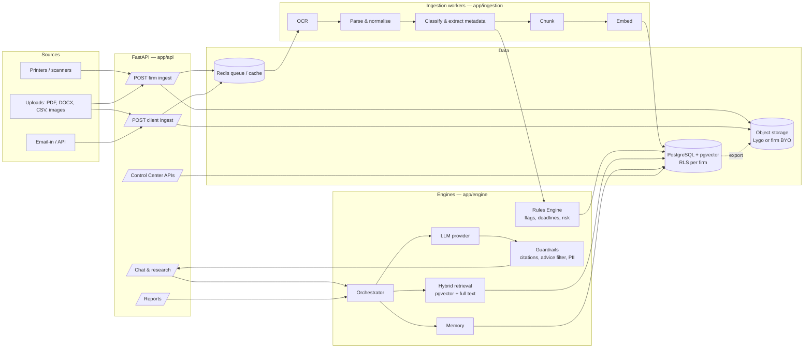

# 02 — Architecture

## System overview

## Components

| Component | Path | Responsibility |
|---|---|---|
| API gateway | `app/api` | Auth, tenant resolution, validation, rate limiting, OpenAPI |
| Tenancy core | `app/core/tenancy.py` | Resolves `firm_id` / `client_id` per request; sets Postgres session vars for RLS |
| Domain services | `app/domain/*` | Firms, clients, matters, documents, users, audit — no HTTP code here |
| Ingestion | `app/ingestion` | OCR, parsing, classification, metadata extraction, de-duplication |
| Rules Engine | `app/engine/rules` | Deterministic rule packs (YAML + Python) → flags, deadlines, risk score |
| RAG | `app/engine/rag` | Chunking, embeddings, hybrid search, reranking, citation objects |
| AI | `app/engine/ai` | LLM provider adapters, prompt templates, guardrails |
| Memory | `app/engine/memory` | Conversation memory and matter "fact sheets" |
| Orchestrator | `app/engine/orchestrator` | Picks the pipeline per task (explain, research, draft, summarise, report) |
| Reports | `app/reports` | Report and analytics generation (PDF, DOCX, CSV, JSON) |
| Storage | `app/storage` | One interface over Lygo-managed and firm-provided destinations |
| Integrations | `app/integrations` | Thrivewave SMS, email, outbound webhooks |
| Workers | `app/workers` | Celery tasks for long-running work |

## Key request flows

### 1. Client uploads a document

1. `POST /v1/firms/{firm}/clients/{client}/documents` — file stored in the firm's primary
   storage destination; a `document` row is created with `status=received`.
2. Worker: OCR (if image/scan) → parse → classify type (e.g. *insurance policy*, *work permit*,
   *tenancy agreement*) → extract metadata (parties, dates, amounts).
3. Rules Engine runs the rule pack for that document type → `flags` rows.
4. Chunk + embed into the **client scope** of the vector index.
5. Notify: in-app + optional SMS ("Your document has been reviewed — log in to view").
   SMS never contains case details (see [10](10-notifications-sms.md)).

### 2. Client asks "What does clause 7 mean?"

1. Orchestrator task = `explain`. Retrieval scopes: this client's documents + Public Law Corpus.
   Firm knowledge base is **not** exposed to clients unless the firm publishes items to clients.
2. LLM writes a plain-language answer at a configurable reading level, with citations.
3. Guardrails: citation check, "information not advice" framing, escalation prompt
   ("Ask your advocate") when the question asks for a legal decision.
4. Conversation stored in memory; advocate can see client chat history for the matter.

### 3. Advocate builds a case

1. Task = `research` / `case_build`. Scopes: Public Law Corpus + firm knowledge base + matter documents.
2. Multi-step: issue spotting → retrieve statutes and precedents → draft argument outline
   → each authority verified against the corpus (no unverified citations returned).
3. Output saved to the matter as a draft work product; can be exported as DOCX.

## Non-functional targets (MVP)

| Area | Target |
|---|---|
| Availability | 99.5% monthly |
| Chat latency | first token < 3 s p95 |
| Ingest | 20-page scanned PDF processed < 2 min p95 |
| RPO / RTO | 15 min / 4 h |
| Isolation | zero cross-tenant reads, enforced in DB (RLS) and tested in CI |
