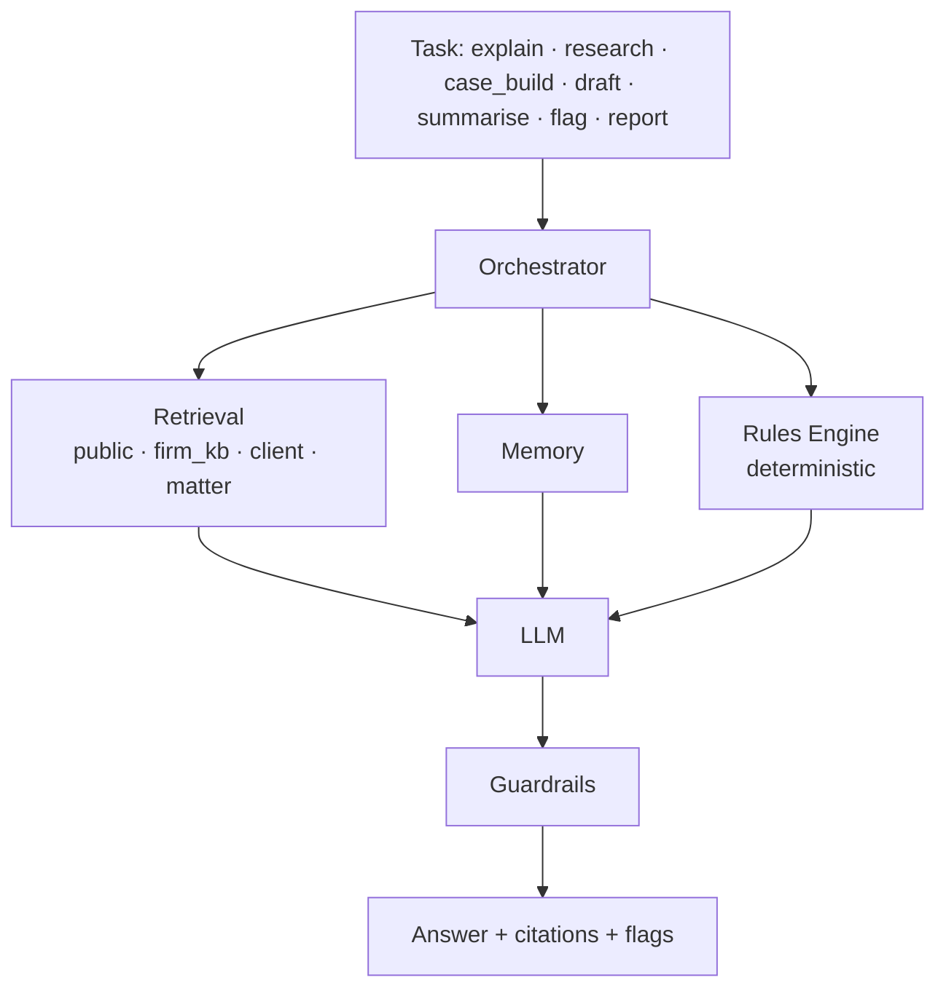

# 04 — AI & Rules Engines

Lygo has **two engines** that share one retrieval layer and one orchestrator.



## 1. Rules Engine (in-built) — `app/engine/rules`

Deterministic, explainable, cheap. Runs on every ingested document.

- **Rule packs** per document type and practice area, stored in `app/engine/packs/<id>/rules.yaml`
  (see [ADR 0004](adr/0004-practice-area-packs.md)) as YAML (declarative checks) with optional Python hooks for complex logic.
- Rule types: pattern / clause presence or absence, value thresholds (e.g. excess amount),
  date logic (expiry, limitation periods, notice windows), cross-field consistency
  (names/ID numbers match across documents), required-attachment checks.
- Output: `Flag { severity: info|caution|warning|critical, code, title, plain_explanation,
  span (page, offsets), rule_id, source_refs[] }`.
- Deadlines extracted become `matter_deadlines` and can trigger reminders.
- Firms can enable/disable rules and add their own rules in the Control Center.

Example rule (YAML):

```yaml
id: ins.exclusion.pre_existing
doc_types: [insurance_policy]
severity: warning
when:
  clause_matches: ["pre-existing condition", "pre existing illness"]
explain: >
  This policy excludes conditions you had before it started. Claims linked to
  those conditions may be refused.
source_refs: []        # optional statute references from the public corpus
```

Rule packs are reviewed by an advocate before release; each pack has fixtures in `tests/unit/rules/`.

## 2. AI Engine — `app/engine/ai`

- **Provider interface** (`providers/base.py`): `generate()`, `stream()`, `embed()`.
  Adapters: OpenAI-compatible (covers RumptyCloud inference and most hosted/self-hosted
  models), plus room for others. Model choice per task is config, not code.
- **Prompts** (`prompts/`): versioned templates per task and audience (`advocate`, `client`).
  Prompt version is stored with every AI output for audit.
- **Data handling with providers**: only send the minimum chunks needed; strip or mask
  identifiers where the task allows; contractually prohibit providers from retaining or
  training on Lygo data (see [07](07-security-and-compliance.md) on onward transfers).

### Tasks

| Task | Audience | Scopes | Notes |
|---|---|---|---|
| `explain` | client | client, public, firm_kb(shared) | Plain language, reading-level setting, Swahili later |
| `flag_explain` | client | flag + document span | Expands a rules-engine flag into a short explanation |
| `research` | advocate | public, firm_kb, matter | Must return authorities with verified citations |
| `case_build` | advocate | public, firm_kb, matter | Issues → facts → law → arguments → gaps checklist |
| `draft` | advocate | firm_kb templates, matter | Advocate-only; output is a draft for professional review |
| `summarise` | both | matter | Matter / document summaries |
| `report` | advocate | matter, analytics | Feeds `app/reports` |
| `compare` | advocate | matter, firm_kb, public | Deterministic alignment ([ADR 0005](adr/0005-comparison-engine.md)); AI only explains/labels |
| `fact_check` | advocate | public, firm_kb, matter | Cite-check and claim-check; verdicts: supported / contradicted / partially / not found, each with evidence |
| `chronology` | advocate | matter | Dated events from documents, each linked to its source |
| `advise_memo` | advocate | public, firm_kb, matter | Draft for advocate approval; never client-facing without approval |

The orchestrator uses a task registry: each task declares scopes, audience, guardrails, prompt and
whether approval is required, so new tasks do not require edits to a central switch.

## 3. RAG layer — `app/engine/rag`

- **Chunking** (`chunking/`): structure-aware. Statutes split by Part → Section → Subsection,
  keeping the section number and title as metadata. Contracts split by clause. Judgments by
  paragraph number. Fallback: recursive splitting ~800 tokens with overlap.
- **Embeddings** (`embeddings/`): one model for all scopes so they are comparable; model name
  and dimension stored per chunk to allow re-indexing. Batch in workers.
- **Retrieval** (`retrieval/`): hybrid = pgvector similarity + Postgres full-text (BM25-style)
  merged with reciprocal-rank fusion, then a reranker. Always filtered by scope and enforced by RLS.
- **Citations**: each chunk carries `source_id`, `title`, `section/clause/paragraph`, `version`
  (e.g. revision date of an Act), `page`. Answers reference chunk IDs; the API returns resolved
  citation objects the UI can open.
- **Corpus versioning**: Acts change. Each corpus document has `effective_from`/`effective_to`;
  retrieval defaults to the current version, with "as at date" support for older matters.

## 4. Memory — `app/engine/memory`

| Memory | Lifetime | Content |
|---|---|---|
| Conversation | per chat thread | last N turns + rolling summary |
| Matter fact sheet | per matter | structured facts (parties, dates, amounts, issues) extracted and confirmed by advocates |
| User preferences | per user | reading level, language, tone |
| Firm style | per firm | drafting conventions learned from approved templates |

Memory is tenant-scoped like everything else and is included in data export and deletion.
Facts proposed by the AI are marked `unconfirmed` until an advocate confirms them.

## 5. Guardrails — `app/engine/ai/guardrails`

1. **Citation verification** — every cited authority must resolve to a chunk in the corpus or
   firm KB; unresolved citations are removed and the answer is regenerated or marked. This
   directly addresses the problem of fabricated case law in court filings that the Kenyan
   Judiciary has been tightening rules on.
2. **Advice boundary (client audience)** — classifier detects requests for a legal decision or
   strategy ("Should I sue?", "Draft my appeal"); response explains the general position and
   routes to the firm ("Ask your advocate" → creates a task for the assigned advocate).
3. **Approval mode** — firm setting: client-facing AI answers are held for advocate approval
   before the client sees them.
4. **PII handling** — mask national ID, KRA PIN, phone numbers in logs; never log prompt bodies
   in plain text in production.
5. **Prompt-injection defence** — retrieved document text is treated as data; system prompts
   instruct the model to ignore instructions inside documents; tool use limited.
6. **Confidence & abstain** — if retrieval returns nothing relevant, say so rather than guess.

## 6. Evaluation

`tests/eval/` holds a golden set per practice area (question → expected authorities → rubric),
run on every prompt/model change: citation accuracy, faithfulness, refusal correctness on
advice-seeking questions, reading level for client answers.
