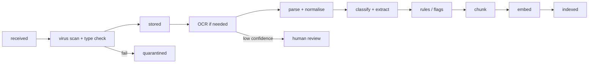

# 05 — Ingestion Pipeline

## Two ingest endpoints (plus the public corpus)

| Endpoint | Who | Goes to scope | Typical content |
|---|---|---|---|
| `POST /v1/firms/{firm_id}/knowledge/documents` | Firm members | `firm_kb` | Precedents, templates, opinions, research memos, internal guides |
| `POST /v1/firms/{firm_id}/clients/{client_id}/documents` | Firm members **or** the client | `client` (optionally `matter_id`) | Contracts, policies, permits, IDs, letters, court papers |
| Corpus loader (CLI / platform admin) | Platform | `public` | Constitution, Acts, regulations, (licensed) case law |

Both firm/client endpoints accept: multipart upload, pre-signed URL upload (large files),
bulk ZIP, and later email-in (`<firm>.<client>@in.lygo...`) and scanner hot-folders.

> **Status:** the upload doors, validation, storage, OCR interface, parse, structure, classify and rules stages are
> implemented (see [14](14-implementation-plan.md)). Chunk/embed (stage `indexed`) arrives with the RAG layer.

## Stages

1. **Validation** — MIME sniffing (not file extension), size limits, ClamAV scan, password-protected PDF detection.
2. **Storage** — original file written to the firm's primary destination, SHA-256 hash recorded
   (deduplication + evidence of integrity).
3. **OCR** — `app/ingestion/ocr`: deskew/denoise, Tesseract or PaddleOCR (English; Swahili model
   available), per-page confidence. Handwriting is unreliable — pages below threshold go to a
   human review queue in the firm workspace.
4. **Parse** — `parsers/`: PDF text layer (pdfplumber/PyMuPDF), DOCX (python-docx), CSV/XLSX
   (pandas) with schema detection, email (.eml/.msg). Output a normalised `DocumentText`
   with pages, blocks, tables.
5. **Classify & extract** — `classify/`: document type, language, parties, dates, amounts,
   reference numbers (case no., policy no., permit no.). Rules first, model fallback.
6. **Rules Engine** — see [04](04-ai-engine.md).
7. **Chunk & embed** — structure-aware chunking; embeddings written to `chunks`.
8. **Notify** — websocket/SSE event to UI; optional SMS/email.

Each stage is an idempotent Celery task; `documents.status` and `ingest_events` record progress
so the UI can show a timeline and retries are safe.

## Data arrangement

Every document gets:
- `doc_type` (taxonomy in `app/ingestion/classify/taxonomy.yaml`), `practice_area`,
- `tags` (firm-defined), `matter_id`, `client_id`,
- extracted `entities` (people, organisations, IDs) linked to the matter fact sheet,
- `sensitivity` (normal / sensitive — e.g. health, biometric, children, ethnicity data) which
  drives stricter handling (see [07](07-security-and-compliance.md)).

## Public Law Corpus

- Sources listed in `corpus/manifests/*.yaml` with URL/source, version date, licence and checksum.
- **Licensing check required before production**: Kenya Law (NCLR) states its website content is
  shared on a non-commercial licence, with attribution. Lygo is commercial, so obtain written
  permission/licence from NCLR, or source legislation from official publications. Do not scrape
  without that sorted. Tracked in [OPEN-QUESTIONS](OPEN-QUESTIONS.md).
- Amendments: scheduled job checks for new legal notices/amendment Acts; new versions are
  ingested with `effective_from` dates; old versions kept.
