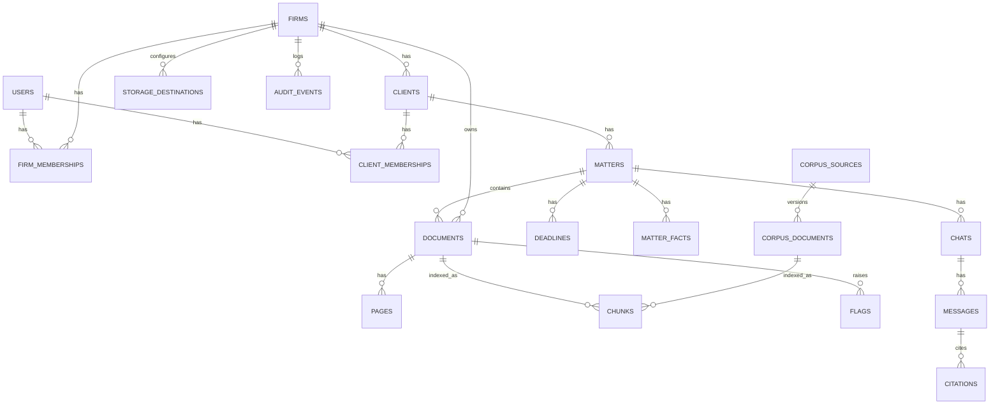

# 09 — Data Model

## Core tables (abridged)

| Table | Key columns | Notes |
|---|---|---|
| `users` | id, email, phone, name, password_hash, mfa_secret_enc, locale | Global identity |
| `firms` | id, slug, name, plan, region_pref, branding jsonb, ai_settings jsonb, kms_key_ref | Tenant |
| `firm_memberships` | firm_id, user_id, role, status | Unique (firm_id, user_id) |
| `clients` | id, firm_id, type (individual/business), name, contacts enc, sensitivity | Sub-tenant |
| `client_memberships` | client_id, firm_id, user_id, role | Portal access |
| `matters` | id, firm_id, client_id, title, practice_area, status, assigned_user_ids[], opened_at | Case |
| `documents` | id, firm_id, client_id?, matter_id?, scope, doc_type, title, sha256, storage_destination_id, storage_key, status, sensitivity, language, page_count, uploaded_by | scope ∈ firm_kb, client |
| `pages` | document_id, firm_id, n, text, ocr_confidence, needs_review | |
| `chunks` | id, firm_id?, client_id?, scope, source_type, source_id, section_ref, text, embedding vector(N), embed_model, tsv tsvector, effective_from/to | HNSW index on embedding; GIN on tsv |
| `flags` | id, firm_id, client_id, document_id, rule_id, severity, title, explanation, span jsonb, status, resolved_by | |
| `deadlines` | id, firm_id, matter_id, due_at, kind, source_flag_id, reminded_at | |
| `matter_facts` | id, firm_id, matter_id, key, value jsonb, source_chunk_id, confirmed_by | Memory |
| `chats` / `messages` | firm_id, client_id?, matter_id?, audience, role, content, prompt_version, model, approved_by | |
| `citations` | message_id, chunk_id, verified bool | |
| `reports` | id, firm_id, matter_id?, type, format, storage_key, status | |
| `storage_destinations` | id, firm_id, kind, region_country, config jsonb, credentials_enc, health | |
| `storage_policies` | firm_id, policy jsonb | |
| `consents` | id, firm_id, client_id, user_id, purpose, text_version, granted_at, withdrawn_at | Cross-border / sensitive data consent |
| `audit_events` | id, firm_id?, actor_id, action, target, ip, at, meta jsonb | Append-only |
| `corpus_sources` / `corpus_documents` | id, title, kind (constitution/act/regulation/judgment), cap_no, version_date, licence, checksum | firm_id NULL |
| `notifications` | id, user_id, firm_id, channel, template, status, provider_msg_id | |

### Implemented since this document was written
`invitations`, `deadlines`, `tasks`, `refresh_tokens`, `notifications`, `ingest_events`, `document_fields`, `entities`,
`entity_mentions`, `storage_destinations`, `corpus_documents` (versions of public sources), and `chunks` (with `embedding vector(1024)`,
generated `tsv`, `effective_from/to`, `shared_with_clients`). `users.platform_role` and `firms.wrapped_dek` were added.
`document_versions` is realised as `documents.version_group_id/version_no`; `document_sections` and `flags` follow doc 05.

All tenant tables: `firm_id` NOT NULL (except public corpus), RLS enabled and forced,
`created_at`, `updated_at`, soft-delete `deleted_at` where retention rules require it.
